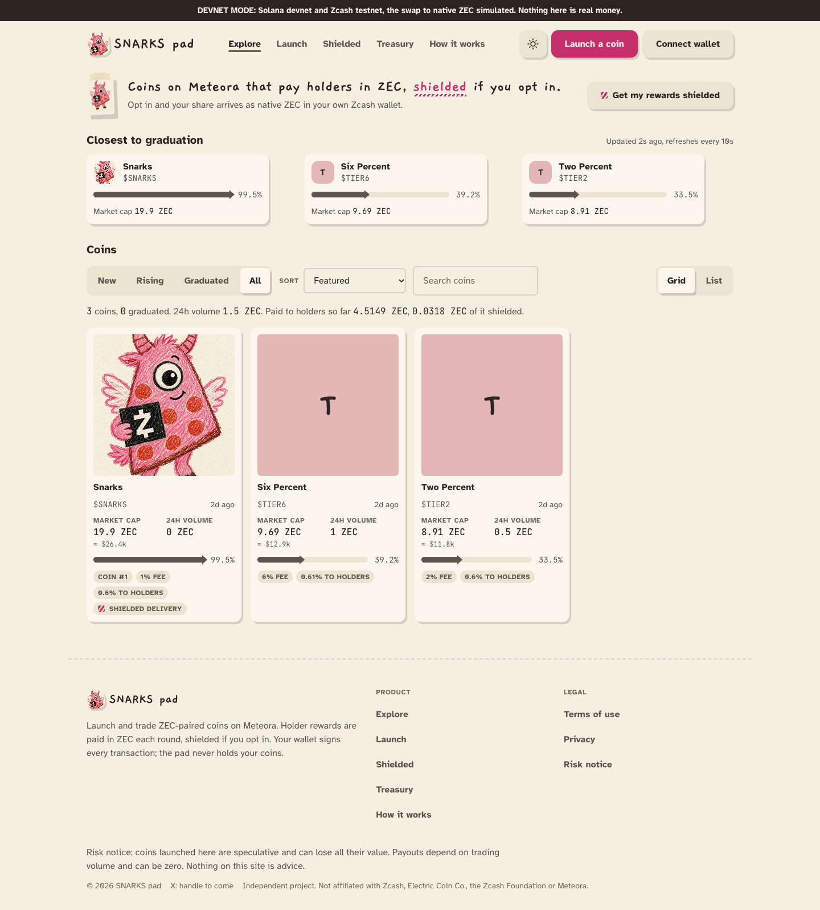
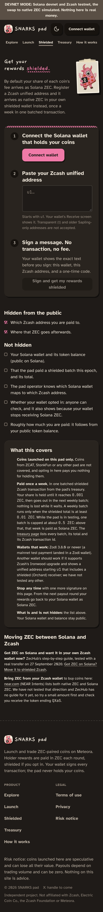
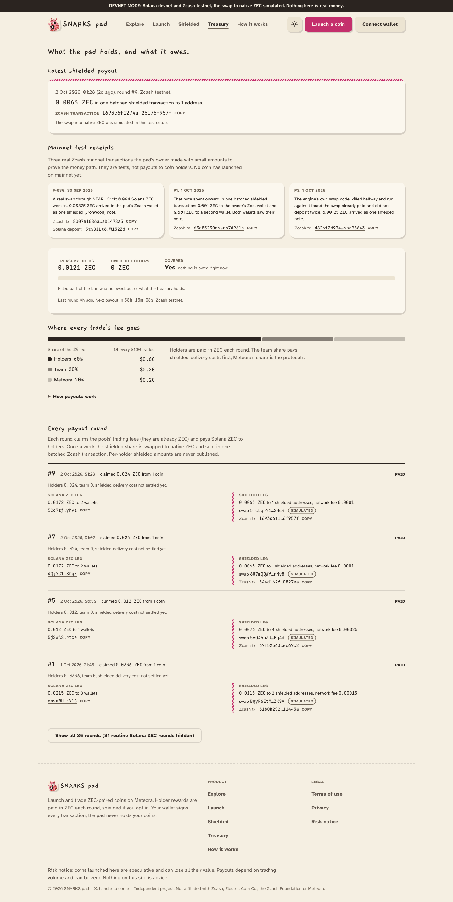
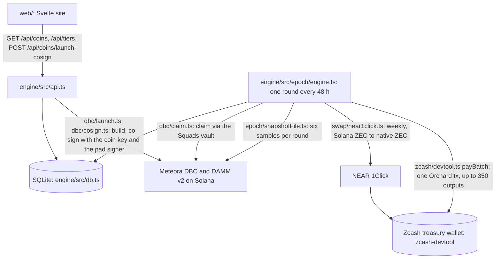

<div align="center">

# SNARKS pad


[](https://snarks.fun)

### Coins on Meteora that pay their holders in ZEC, shielded if you opt in.

**A Solana launchpad on Meteora's Dynamic Bonding Curve where every coin is quoted in ZEC. Each trade pays a 1% fee; 60% of it goes to the coin's holders every 48 hours as Solana ZEC, or as native ZEC in their own shielded Zcash wallet if they opt in once. The first mainnet round ran on 2026-10-07: two vault claims, one bridge swap, one shielded batch.**

**[ Live ↗ ](https://snarks.fun)** · **[ Test site, free test money ↗ ](https://test.snarks.fun)** · **[ Verify it yourself ↗ ](#verify-it-yourself-in-90-seconds)** · **[ The receipt ↗ ](https://mainnet.zcashexplorer.app/transactions/63a85230d6cef5a5465b3d9a34327de89f8c63c47a5a6b8e01e31004ca7d961c)** · **[ Payouts page ↗ ](https://snarks.fun/#/treasury)**

Built for the Colosseum Crypto World's Fair (Zcash track) and the Superteam Meteora DBC sidetrack.

</div>

---

## ▶ Demo

*The test site on devnet, as captured on 2026-10-05. Every screen is the real app against a real devnet pool and a Zcash testnet wallet.*

| The market page at 1440 px (devnet coins, fees paid so far) | The shielded opt-in page at phone width (connect, paste a Zcash address, sign) | The payouts page at 1440 px (one round's Solana ZEC payouts and its shielded batch, with transaction ids) |
|---|---|---|
|  |  |  |

---

## Table of contents

- [The problem](#the-problem)
- [What SNARKS pad is](#what-snarks-pad-is)
- [Verify it yourself in 90 seconds](#verify-it-yourself-in-90-seconds)
- [What's real, and what we deliberately did not claim](#whats-real-and-what-we-deliberately-did-not-claim)
- [Architecture](#architecture)
- [How it works](#how-it-works)
- [What it costs and how it behaves under load](#what-it-costs-and-how-it-behaves-under-load)
- [Tech stack](#tech-stack)
- [Project layout](#project-layout)
- [Run it locally](#run-it-locally)
- [Tests](#tests)
- [Security review](#security-review)
- [License](#license)

---

## The problem

- **ZEC rewards from memecoins stay on Solana.** About 86,000 Solana wallets have received ZEC as holder rewards from ZEC-paired coins (about 9,400 ZEC), and bridging from those wallets is close to zero (Zcash community forum, 2026-09-24).
- **The way out is manual.** A holder who wants shielded ZEC does a bridge swap by hand after every payout, and each swap pays the bridge's withdraw fee (32,000 zats, measured 2026-09-27), which is larger than many small rewards.
- **Nothing delivers the rewards shielded for them.** Every other holder bridges by hand or trusts a custodian.

---

## What SNARKS pad is

A launchpad and a payout engine. The loop:

<div align="center">

**`LAUNCH → TRADE → CLAIM FEES → SWAP TO NATIVE ZEC → PAY HOLDERS`**

</div>

1. **Launch.** A creator launches a coin on Meteora DBC quoted in Solana ZEC. The fee tier, name and image are fixed at launch. The config's fee scheduler is a five-second launch window (99% in the first second, falling to the tier fee), and every launch carries the pad's common signer so trading terminals can attribute it.
2. **Trade.** Buys and sells on the bonding curve pay the tier fee in ZEC: 20% to Meteora, the rest claimed by the pad and split 75% to holders and 25% to the team. On the 1% tier a trade pays holders 0.60% and the team 0.20%. At graduation the pool migrates to DAMM v2 with all liquidity permanently locked.
3. **Claim.** Every 48 hours the keeper samples holders six times at random moments, then claims each coin's fees through a 2-of-3 Squads vault (the DAMM v2 position fee after graduation).
4. **Swap.** Once a week the opted-in holders' share is swapped from Solana ZEC to native ZEC through NEAR's 1Click bridge into the pad's Zcash treasury. A refused or refunded swap carries the share to the next shielded round; it never falls back to the public rail.
5. **Pay.** Holders who did not opt in get Solana ZEC every round. Opted-in holders get one Orchard transaction a week from the treasury, up to 350 recipients a transaction. The public sees that a batch was paid, not which address got what.

---

## Verify it yourself in 90 seconds

No wallet, no key and no chain are needed for the first four lines; the test suite needs Bun. Every expected result below was produced by a run on 2026-10-08 before it was written here.

```bash
# 1. The mainnet instance: payouts running, the first round recorded
curl -s https://snarks.fun/api/treasury | jq '{lastEpochAt, nextEpochAt, paused, zcashNetwork}'
# → {"lastEpochAt":"2026-10-07T13:10:54.800Z","nextEpochAt":"2026-10-09T13:10:54.800Z","paused":false,"zcashNetwork":"main"}

# 2. The fee tiers and the common launch signer the terminals attribute launches to
curl -s https://snarks.fun/api/tiers | jq '{tiers: (.tiers|length), launchpadSigner, quoteMint}'
# → {"tiers":5,"launchpadSigner":"GQgxCQnzCJQKYP8m5FyyGDVe33ysBmJWvghoVFBFDfmX","quoteMint":"A7bdiYdS5GjqGFtxf17ppRHtDKPkkRqbKtR27dxvQXaS"}

# 3. The test site: the same product on devnet with free test money
curl -s https://test.snarks.fun/api/coins | jq '[.coins[].symbol]'
# → ["BLUES","GREENS","SNARKS"]

# 4. A shielded batch from this engine on Zcash mainnet (two outputs, 2026-10-01)
open https://mainnet.zcashexplorer.app/transactions/63a85230d6cef5a5465b3d9a34327de89f8c63c47a5a6b8e01e31004ca7d961c
# → height 3,502,208; the engine's own bridge swap landed as tx d826f2d9747992fbb242f40d5705359db75e3b56bd522175a75cfa416bc96643 at height 3,502,669

# 5. The fast test lane (no chain, about three minutes)
git clone https://github.com/Yonkoo11/snarks-pad && cd snarks-pad/engine && bun install && bun run test
# → 824 pass, 0 fail, 71 files (2026-10-08)
```

What this proves: the mainnet engine is running on the code in this repository, the fee tiers and the signer are live, the shielded batch rail has paid real outputs on Zcash mainnet, and the money-path tests pass without a chain. What it does not prove: that an outside holder has been paid (none has yet, see the next section), or that the full chain lane passes on your machine (it needs the local validator and the Zcash regtest stack described under Tests).

---

## What's real, and what we deliberately did not claim

| Capability | Status |
|---|---|
| **Engine tests** | Real. Full chain lane 1,450 pass, 0 fail, 131 files against a local validator with the real Meteora DBC, DAMM v2 and Squads programs and a Zcash regtest node (2026-10-07). Fast lane 824 pass, 0 fail, 71 files (2026-10-08). |
| **A full mainnet round** | Real. 2026-10-07: two Squads claims approved by the owner, one 1Click swap (230,081 zats in, 205,081 out), one shielded batch to the two wallets that had opted in. Listed on the Payouts page. |
| **The shielded batch rail on Zcash mainnet** | Real. One batch of two outputs (tx 63a85230…, height 3,502,208) and the engine's own bridge swap (tx d826f2d9…, height 3,502,669). Batches of 20, 100 and 625 recipients measured on regtest; the engine caps a transaction at 350. |
| **Graduation and the DAMM v2 position fee** | Tested, not yet exercised on mainnet. The migration and the position-fee claim run in the chain lane; no mainnet coin has filled its curve. |
| **Load** | Measured on the test site, 2026-10-08: 400 reads at concurrency 25, all 200, p50 1.1 s, p95 2.6 s. Bursts of 30 launch builds or 80 trade builds from one address: the per-address cap refuses 20, the rest get 503 while the devnet RPC recovers. |
| Public coins on mainnet | Not yet. The two coins on mainnet are the team's rehearsal coins and the public board lists none; the first public coin is still to launch. |
| Outside holders paid | None yet. The two opted-in wallets paid in round 1 were the team's own. |
| Trading-terminal listing | Not yet. The common launch signer is live; listings follow traction. |
| Outside security audit | Not claimed. Five internal review rounds with static analysis and manual passes are summarised in [SECURITY.md](SECURITY.md). |
| Continuous integration | Not set up. The badges above carry numbers from runs made on 2026-10-07 and 2026-10-08, with their dates. |
| Demo video | Not yet made. The stills above are real captures of the test site. |
| "Anonymous" | Not claimed, anywhere. The site says what is hidden (receiving addresses, per-holder amounts) and what is not (Solana balances, the batch and its total). |

---

## Architecture



The boundary between the site and the chain is `engine/src/api.ts`; between the keeper and Meteora, `engine/src/dbc/claim.ts`; between Solana and Zcash, `engine/src/swap/near1click.ts` and `engine/src/zcash/devtool.ts`.

---

## How it works

### Fee split

| Where a 1% trade fee goes | Share of the trade |
|---|---|
| Meteora | 0.20% |
| Holders (75% of the pad's claim) | 0.60% |
| Team (25% of the pad's claim) | 0.20% |

Tiers above 1% (2%, 4% and up) carry a creator share from the pad's claim, and a launcher may hand that share to a named wallet in the launch transaction. The 1% tier has no creator share and the API refuses a creator wallet on it.

### Launch window

Every coin's first five seconds cost more than the tier fee, written into the Meteora config:

| Second | Fee on the 1% tier |
|---|---|
| 0 | 99% |
| 1, 2, 3, 4 | 79.4%, 59.8%, 40.2%, 20.6% |
| 5 and after | 1%, for good |

The launcher's own first buy inside the launch transaction pays the tier fee. Anyone else's buy in the window pays the step, and holders get their usual share of it.

### Payout cadence

- Solana ZEC payouts every 48 hours; shielded payouts once a week, when the opted-in share covers the delivery reserve.
- Fees of a coin that nobody holds through a round are not claimed. Fees already held for such a coin wait 30 days, then a quarter goes to the team and the rest to the holders paid in that round.
- A refused or refunded swap carries the opted-in share to the next shielded round. The only way out of the shielded rail is the holder switching it off.

### Privacy and custody

- Hidden: which Zcash address a holder is paid to, and each holder's amount inside a batch. The published payout snapshot carries a count, a total and one salted commitment per shielded row.
- Not hidden: Solana wallets and balances, opt-in status, the existence and total of each batch, every transaction id.
- Custody: the pad's share of fees sits in a 2-of-3 Squads vault; the keeper can propose a claim and cannot execute one alone. The Zcash treasury's key material is an age-encrypted identity file, never an environment variable, and the `zcash-devtool` binary is pinned to a recorded checksum that is checked before it runs.

---

## What it costs and how it behaves under load

Measured on 2026-10-08 (local chain for the costs, the live test site for the load):

| Measure | Value |
|---|---|
| Launch cost to the creator | 0.0116 SOL (11,603,400 lamports) plus the first buy |
| RPC calls per route | launch build 9, confirm 3, trade build 9, quote 4, coin page 5, board with 62 coins 124 |
| Caps | 10 launch builds a minute per address, 100 a minute pad-wide, 60 chain reads a minute per address, 3,000 an hour pad-wide |
| 400 reads at concurrency 25 | all 200; p50 1,108 ms, p95 2,622 ms, max 4,203 ms |
| 30 launch builds at once | 20 refused by the per-address cap (429), 10 answered 503 while the devnet RPC recovered |

The measurement scripts are not in this repository; the numbers are the API's own counters and plain HTTP timing.

---

## Tech stack

- **Engine:** TypeScript on Bun, SQLite, Meteora DBC and DAMM v2 SDKs, Squads, NEAR 1Click API, `zcash-devtool` (pinned commit, checksum checked).
- **Site:** Svelte and Vite, no login, no cookies.
- **Chains:** Solana mainnet and devnet; Zcash mainnet (Orchard) and testnet; a local validator and a Zcash regtest stack for the tests.
- **Infrastructure:** Ubuntu, Caddy, one keeper and one API service per instance, encrypted off-box backups.

---

## Project layout

```
engine/                  # the keeper and the HTTP API (Bun)
  src/
    api.ts               # every route, the per-address and pad-wide caps
    api/                 # launch limits, trader routes, flood alerts
    dbc/                 # Meteora: configs, launch, co-sign, launch signer, trade, claim, migrate
    epoch/               # a round: samples, fee split, payouts, carry rules, orphan release
    swap/                # NEAR 1Click: quote, deposit, resume, loss cap
    zcash/               # zcash-devtool wrapper: wallet, batch payment, expired-tx detection
    db.ts                # SQLite schema and the crash-safe writes
  test/                  # 131 files; the fast lane runs without a chain
  scripts/               # local:up, seed, epoch, api, keeper
web/                     # the Svelte site: market, coin, launch, shielded, payouts, profile
  src/routes/
  src/components/
ops/                     # provisioning, service units, instance update, backups (no instance data)
docs/stills/             # the three captures above
SECURITY.md              # what was reviewed, what was fixed, what is not covered
```

---

## Run it locally

```bash
cd engine
bun install

bun run local:up        # starts the local validator with the Meteora and Squads programs and the Zcash regtest stack
bun run seed            # creates the DBC config, launches test coins, simulates traders
bun run epoch           # runs one round: claim, swap (simulated), pay
bun run api &           # serves the API on :8787
curl -s http://localhost:8787/api/coins | jq '.coins | length'
```

The site runs with `cd web && bun install && bun run dev` against that API.

---

## Tests

```bash
cd engine
bun run test            # fast lane, no chain: 824 pass, 0 fail, 71 files (2026-10-08)
bun run test:fast       # the same lane
```

The full chain lane (`bun run e2e` with `bun run local:up` running) adds every test that needs the validator or the regtest node: 1,450 pass, 0 fail, 131 files on 2026-10-07. It covers launch and co-sign, the launch window, claims through the vault, graduation and the DAMM v2 position fee, the holder samples, the swap state machine with refusals and refunds, batch payments and expired-transaction resend. Run one lane at a time; the lanes share a test database.

---

## Security review

Five internal review rounds between 2026-10-01 and 2026-10-07, each with static analysis and manual passes over the money paths, with every fix landing with a test. The summary, the fixes and what is not covered are in [SECURITY.md](SECURITY.md). This is not an outside audit.

---

## License

MIT. See [LICENSE](LICENSE).
